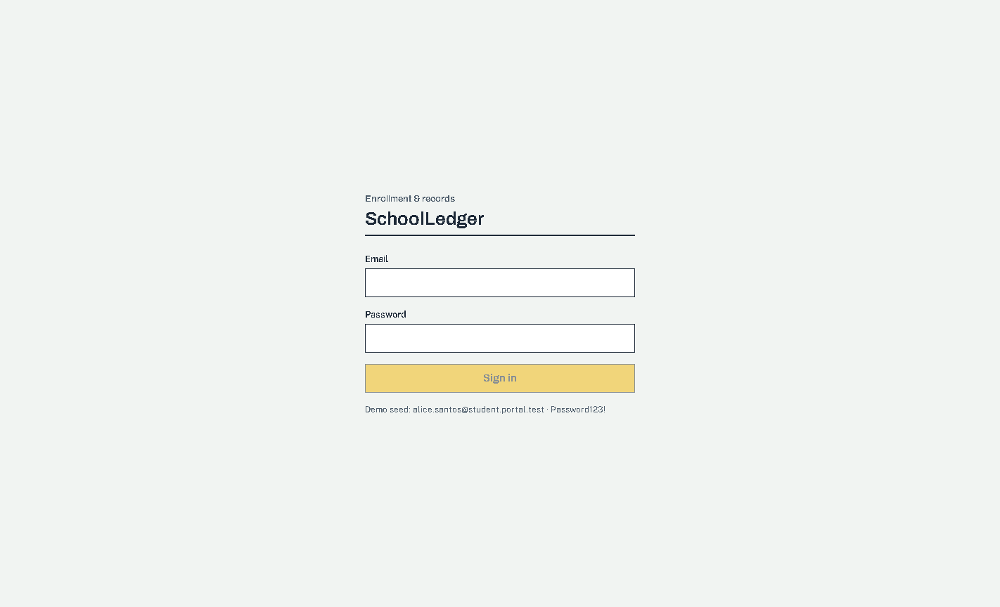
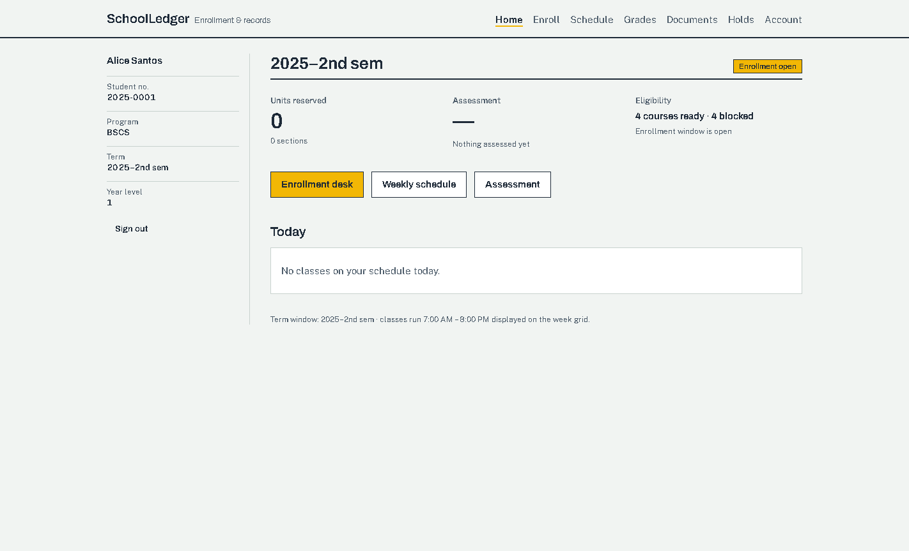

<div align="center">

# SchoolLedger

**The school information system that treats records like records.**

Enrollment under strict capacity, an append-only grade ledger, cryptographically signed
documents that verify without an account, and an audit trail you can mathematically check.
Higher-ed first, K-12 mode designed in — delivered as SaaS or self-hosted.

[](https://github.com/mrfost07/SchoolLedger/actions/workflows/ci.yml)

</div>




## What this is

SchoolLedger is a school information & academic management system (SIS). The current core is a
fully audited, single-school implementation with a student-facing web client:

- **Capacity-safe enrollment** — 50 concurrent reservations against a 5-seat section end with
  exactly 5 enrollments (Redis Lua gate + ordered row locks + a database CHECK as the last line
  of defense).
- **Immutable grade ledger** — POSTED grade entries are frozen by a database trigger; every
  change flows through supersede/rectification and a verifiable SHA-256 hash chain.
- **Verifiable documents** — what you request is frozen as a JSON snapshot, HMAC-signed, and
  rendered to PDF with a QR that resolves to a blind public verification endpoint
  (`/api/v1/public/verify/:serialHash`) revealing only `valid`, `studentName`, and a masked
  student number.
- **Append-only audit** — per-aggregate hash-chained audit entries.

The multi-tenant platform (school tenancy with Postgres RLS, registrar/admin/instructor/cashier
consoles, payments, admissions, K-12 mode) is being built on this core. Roadmap and evidence
mapping: [RECONSTRUCTION_LEDGER.md](RECONSTRUCTION_LEDGER.md) · architecture decisions:
[docs/adr](docs/adr).

## Stack

| Concern | Choice |
| --- | --- |
| HTTP | Fastify 5 + `@fastify/type-provider-typebox` (runtime-validated schemas) |
| Contract | `@fastify/swagger` → OpenAPI 3.1 (`openapi.json`, 61 paths) |
| Database | PostgreSQL 14+ via Prisma 6, hardened with raw SQL (`btree_gist` EXCLUDE, CHECK, triggers) |
| Cache / queues | Redis (ioredis) + BullMQ; graceful inline fallback when Redis is absent |
| Auth | Custom HS256 JWT (access + MFA-scoped), rotating refresh tokens, TOTP step-up |
| Crypto | argon2id passwords, HMAC-SHA256 document signatures, SHA-256 serial hashes |
| Documents | `pdf-lib` renderer, QR codes, S3 presigned URLs (or local signed URLs) |
| Frontend | Next.js 16 (App Router) · React 19 · Tailwind CSS 4 · openapi-fetch typed client |
| Money / grades | `decimal.js` (ROUND_HALF_UP, GWA to 4 dp) |

## Requirements

- Node.js >= 22
- PostgreSQL 14+ with the `btree_gist` extension available (migrations run `CREATE EXTENSION`;
  the role needs superuser or the extension pre-installed)
- Redis (production). In development/tests it is optional — set `REDIS_REQUIRED=false`; capacity
  enforcement falls back to the database path and jobs run inline
- S3-compatible object store (optional; `STORAGE_DRIVER=fs` is the default for dev)

## Quickstart (no Docker required)

```bash
# terminal 1 — infra: embedded Postgres + Redis, migrated and seeded; writes .dev-runtime.json
node node_modules/tsx/dist/cli.mjs scripts/dev-run.ts

# terminal 2 — API + workers on :3000 (env: DATABASE_URL, REDIS_URL + secrets from .dev-runtime.json)
npm run dev

# terminal 3 — web client on :5173
cd frontend && npm run dev
```

Open http://localhost:5173 and sign in with `alice.santos@student.portal.test` / `Password123!`.

<details>
<summary>Docker path</summary>

```bash
cp .env.example .env          # then change every secret
docker compose up -d          # postgres :5432, redis :6379, minio :9000 (+ bucket)
npm install
npm run prisma:generate
npm run prisma:deploy         # applies prisma/migrations (incl. hardening SQL)
npm run seed                  # demo catalog: programs, courses, term, sections, users
npm run dev                   # API + workers on :3000
```

</details>

Poke it: `GET /healthz` (liveness) and `GET /readyz` (DB round-trip + Redis presence).
Live OpenAPI spec: `GET /api/docs/json`.

### Demo accounts (after seed)

Password for all: `Password123!`

| Role | Account |
| --- | --- |
| Admin / Registrar / Chair / Instructor / Cashier | `admin@portal.test`, `registrar@portal.test`, `chair@portal.test`, `instructor@portal.test`, `cashier@portal.test` |
| Students | `alice.santos@student.portal.test`, `ben.reyes@student.portal.test`, `carla.dizon@student.portal.test` |

Term `2025-2A` is open for enrollment.

### Scripts

| Script | Purpose |
| --- | --- |
| `npm run dev` | Watch-mode API + workers |
| `npm run build` / `npm start` | Compile to `dist/` / run the compiled server |
| `npm run typecheck` | `tsc --noEmit` over source, scripts and tests |
| `npm run seed` | Idempotent demo data (`prisma/seed.ts`) |
| `npm run openapi` | Regenerate `openapi.json` from route schemas (no DB needed) |
| `npm test` | Full unit + integration suite (embedded infra, no services needed) |
| `npm run test:unit` | Pure-logic tests (~1 s, no infrastructure) |
| `npm run test:integration` | End-to-end HTTP tests against real Postgres/Redis |

Frontend scripts (in `frontend/`): see [frontend/README.md](frontend/README.md).

## Tests

The backend suite needs **no Docker and no services running**: `tests/helpers/infra.ts` boots an
embedded PostgreSQL (migrations applied) and an in-memory Redis, then tears down. First boot is
slow (initdb + migrations); subsequent files reuse the instance.

- **Unit** — DAG topological order, schedule-overlap math, GWA/standing/honors, grade state
  machine, canonical JSON / HMAC / JWT primitives.
- **Integration** — auth (refresh rotation + reuse detection, TOTP step-up), the enrollment race
  (50 concurrent reservations against 5 seats → exactly 5 enrollments), enrollment flow
  (eligibility, idempotency, holds, waitlists), grading lifecycle (MFA gates, POSTED
  immutability trigger, hash-chain recomputation, rectification), INC lifecycle, and the full
  document pipeline (freeze → sign → presign → verify → revoke).
- **Frontend** — vitest suites for the week-grid geometry, formatting, refresh single-flight,
  and API error mapping.
- **End-to-end** — `scripts/dev-walkthrough.ps1` drives the whole student journey through the
  :5173 origin (session custody, reserve idempotency, prerequisite blocks, waitlists, COR/TOR
  document cycles with PDF bytes and public verification, TOTP step-up, hold-gated official
  downloads, refresh-reuse family revocation).

## Key invariants

Full list with evidence mapping in [RECONSTRUCTION_LEDGER.md](RECONSTRUCTION_LEDGER.md).

- **INV-1** section capacity can never be exceeded, under any concurrency.
- **INV-2** no room or instructor double-booking (`EXCLUDE USING gist` on terms).
- **INV-3** prerequisite graph stays acyclic (DAG service + DB guard on edge writes).
- **INV-4** at most one active grade entry per (student, course, term).
- **INV-5** POSTED grade entries are immutable — enforced by a Postgres trigger.
- **INV-6** audit entries form a verifiable SHA-256 hash chain with per-aggregate sequencing.
- **INV-7** a student's schedule never overlaps.

## API conventions

- **Auth**: `Authorization: Bearer <access token>`. Sensitive operations (grade posting,
  rectification, document revocation, official documents) additionally require a recent TOTP
  step-up (`mfa` claim).
- **Idempotency**: mutating endpoints that move money/units (`POST /enrollments` reservations,
  `POST /documents/requests`) require an `Idempotency-Key` header; replays return the original
  response, mismatched payloads return `409`.
- **Errors**: `application/problem+json` with a stable machine `code`
  (e.g. `SECTION_FULL`, `STUDENT_CLEARANCE_HOLD`, `DOCUMENT_EXPIRED`).
- **Rate limits**: per-IP, per-route budgets (tighter on login, reservations, document requests).

## Project layout

```
prisma/             schema.prisma + migrations (0001_init, 0002_hardening) + seed
scripts/            dev infra/runners, OpenAPI generation, E2E walkthrough
src/
  config/           environment loading and defaults
  core/             crypto (jwt, hash, canonical json), errors/taxonomy, http, time
  infra/            prisma, redis, queues (BullMQ + inline), storage (fs/s3 presign)
  modules/          audit, iam, academics, enrollment, grading, documents
  app.ts            composition root (services + routes)
  workers.ts        background worker entry
  main.ts           API entry
tests/              unit + integration suites and embedded infra helpers
frontend/           Next.js 16 web client (design system, typed API client, auth custody)
docs/               ADRs, teardown synthesis, institution-mode matrix, design docs
```

## Documentation map

| Document | What it covers |
| --- | --- |
| [RECONSTRUCTION_LEDGER.md](RECONSTRUCTION_LEDGER.md) | Every behavioral obligation (`BSL-###`) with implementing file and proving test |
| [AUDIT_REPORT.md](AUDIT_REPORT.md) | Security & correctness audit — findings, fixes, regression tests |
| [docs/adr/](docs/adr) | Architecture decision records (tenancy, identity, academic structure, audit, notifications, payments, packaging) |
| [docs/institution-modes.md](docs/institution-modes.md) | Higher-ed vs K-12 capability matrix |
| [docs/sis-teardown.md](docs/sis-teardown.md) | Field teardown of 4 open-source SIS + commercial demo IA |
| [docs/frontend-design.md](docs/frontend-design.md) | Frontend system design (aesthetic, layout, states) |

## License

Not yet chosen — the self-hosted distribution/licensing decision is tracked in
[docs/adr/0007](docs/adr/0007-self-hosted-packaging.md) (currently a proprietary or
dual-license candidate). Until decided, all rights reserved.
